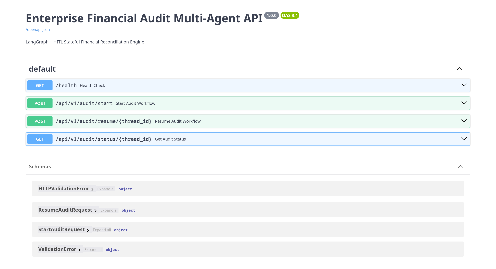
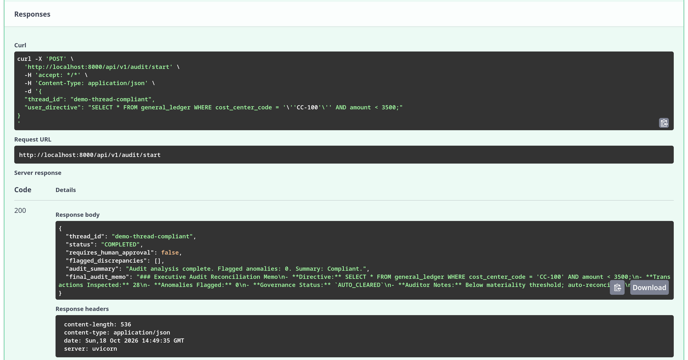
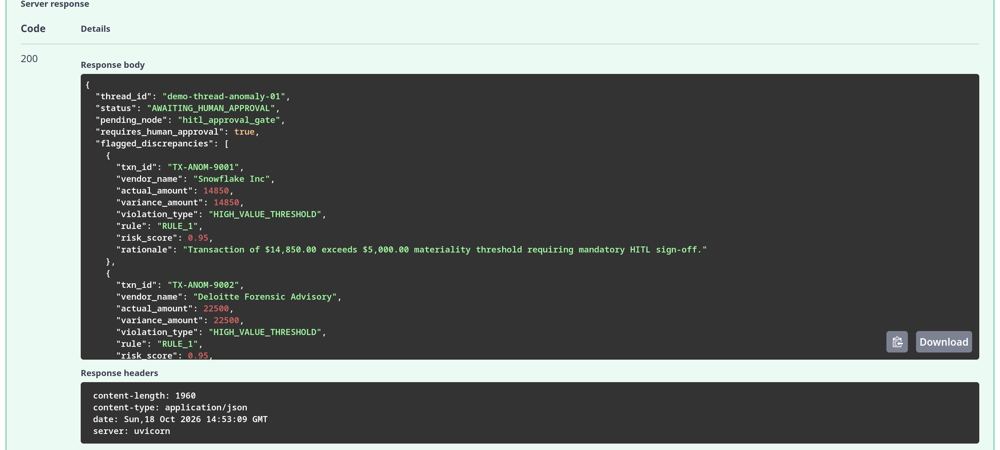
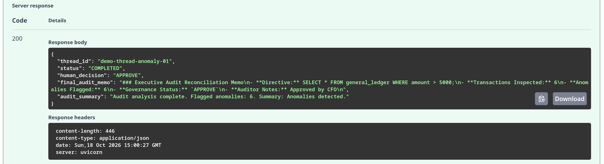
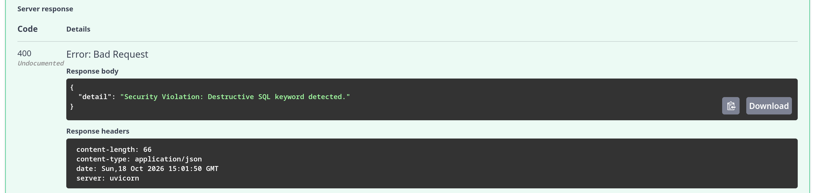

# Enterprise Financial Audit & Variance System (EFAS)

An automated financial audit system built with **Python**, **LangGraph**, **FastAPI**, and **PostgreSQL**. It scans general ledger transactions, checks them against company expense policies, and pauses for human approval whenever high-risk transactions are detected.

<!-- Project Interface / Home Page Screenshot Below: assets/home_interface.png -->


---

## What It Does

Instead of manually sampling a small fraction of invoices after the books close, EFAS checks transactions automatically:
- Scans general ledger records directly from PostgreSQL.
- Checks transactions against 5 key corporate audit rules.
- Automatically clears compliant transactions.
- Pauses the workflow using a Human-in-the-Loop (HITL) review gate if high-value or suspicious items are found.
- Creates an audit summary memo once reviewed.

---

## How It Works

The workflow runs as a simple state machine:

```
[Start]
   │
   ▼
[1. Extract Data]      --> Queries general ledger & cost centers safely
   │
   ▼
[2. Evaluate Rules]    --> Checks transactions against audit policies
   │
   ▼
< Needs Review? >
   ├── Yes (Over $5,000 / Risky) ──> [3. Human Approval Gate] ──> Resumed with Decision
   └── No (Compliant) ─────────────────────┐
                                           ▼
                                 [4. Create Audit Memo]
                                           │
                                           ▼
                                        [End]
```

### Steps:
1. **Extract Data (`sql_extractor_node`)**: Reads transactions from the database based on the user directive.
2. **Evaluate Rules (`compliance_evaluator_node`)**: Checks transactions against the 5 audit rules below.
3. **Human Approval Gate (`hitl_approval_gate_node`)**: If an anomaly or transaction over $5,000 is found, the system pauses and waits for an auditor to approve or reject it.
4. **Create Audit Memo (`report_synthesis_node`)**: Writes a summary memo with the findings and decisions.

---

## Audit Rules

The system checks for 5 common audit issues:

| Rule | Description | What Happens |
| :--- | :--- | :--- |
| **1. High-Value Transactions** | Any transaction over $5,000. | Pauses for human approval. |
| **2. Missing Purchase Order** | Transactions over $2,500 that have no PO number. | Flagged as policy violation. |
| **3. Split Invoices (Structuring)** | Multiple invoices from the same vendor on the same day summing to over $5,000. | Flagged for review. |
| **4. Duplicate Invoices** | Same vendor and exact same amount billed within 48 hours. | Flagged as duplicate. |
| **5. Weekend Travel & Entertainment** | Weekend hospitality/entertainment expenses without VP sign-off. | Flagged for review. |

---

## Project Structure

```text
├── README.md                       # Setup and project documentation
├── docker-compose.yml              # PostgreSQL database container
├── Dockerfile                      # Application container file
├── requirements.txt                # Python dependencies
├── .env.example                    # Environment variable template
├── policies/
│   └── corporate_audit_policy.md   # Ground-truth corporate policy definitions
├── src/
│   ├── config.py                   # App configuration & settings
│   ├── db/
│   │   ├── schema.sql              # Database table definitions
│   │   ├── connection.py           # Database connection helpers
│   │   └── seed.py                 # Sample data generator (200 rows with 15 anomalies)
│   ├── agents/
│   │   ├── state.py                # Graph state definitions
│   │   ├── nodes.py                # Workflow steps (extract, evaluate, gate, report)
│   │   └── graph.py                # LangGraph workflow setup
│   └── api/
│       ├── schemas.py              # Request and response models
│       └── main.py                 # FastAPI endpoints (/start, /resume, /status, /health)
└── tests/
    └── test_audit_graph.py         # Automated test suite
```

---

## Quickstart

### 1. Setup Virtual Environment
```bash
python3 -m venv .venv
source .venv/bin/activate
pip install -r requirements.txt
```

### 2. Configure Environment
```bash
cp .env.example .env
```

### 3. Start PostgreSQL Database
```bash
docker compose up -d
```

### 4. Seed Sample Data
Populates the database with 200 sample transactions (including 15 planted anomalies):
```bash
python src/db/seed.py
```

### 5. Run Tests
Verify all 14 tests pass:
```bash
pytest tests/test_audit_graph.py -v
```

### 6. Start the API
```bash
uvicorn src.api.main:app --reload --port 8000
```

- **Health Check:** `http://localhost:8000/health`
- **Interactive Swagger UI:** `http://localhost:8000/docs`

---

## Test Case Demonstrations

You can run these test cases interactively in the Swagger UI (`http://localhost:8000/docs`) or via `curl`. 

### Test Case 1: Compliant Spend Run (No Anomalies)
- **Endpoint:** `POST /api/v1/audit/start`
- **Path Parameter:** None
- **Request Body (JSON):**
```json
{
  "thread_id": "demo-thread-compliant",
  "user_directive": "SELECT * FROM general_ledger WHERE cost_center_code = 'CC-100' AND amount < 3500;"
}
```
- **Expected Outcome:** `200 OK` with `"status": "COMPLETED"` and `"anomalies_detected": 0`.

<!-- Add Screenshot Below: assets/test_case_1_compliant.png -->


---

### Test Case 2: Material Anomaly Triggered (HITL Gate Pauses Execution)
- **Endpoint:** `POST /api/v1/audit/start`
- **Path Parameter:** None
- **Request Body (JSON):**
```json
{
  "thread_id": "demo-thread-anomaly-01",
  "user_directive": "SELECT * FROM general_ledger WHERE amount > 5000;"
}
```
- **Expected Outcome:** `200 OK` with `"status": "AWAITING_HUMAN_APPROVAL"`, paused at `hitl_approval_gate`.

<!-- Add Screenshot Below: assets/test_case_2_hitl_pause.png -->


---

### Test Case 3: Resume Paused Thread (Human Decision)
- **Endpoint:** `POST /api/v1/audit/resume/{thread_id}`
- **Path Parameter:** `thread_id`: `demo-thread-anomaly-01`
- **Request Body (JSON):**
```json
{
  "human_decision": "APPROVE",
  "notes": "Approved by CFO after review"
}
```
- **Expected Outcome:** `200 OK` with `"status": "COMPLETED"` and `"final_status": "APPROVED"`.

<!-- Add Screenshot Below: assets/test_case_3_hitl_resume.png -->


---

### Test Case 4: SQL Injection Blocked (Security AST Guardrail)
- **Endpoint:** `POST /api/v1/audit/start`
- **Path Parameter:** None
- **Request Body (JSON):**
```json
{
  "thread_id": "demo-thread-injection",
  "user_directive": "SELECT * FROM general_ledger; DROP TABLE general_ledger;"
}
```
- **Expected Outcome:** `400 Bad Request` with rejection message: `AST Validation Failed: Only read-only SELECT queries are permitted.`

<!-- Add Screenshot Below: assets/test_case_4_sql_blocked.png -->


